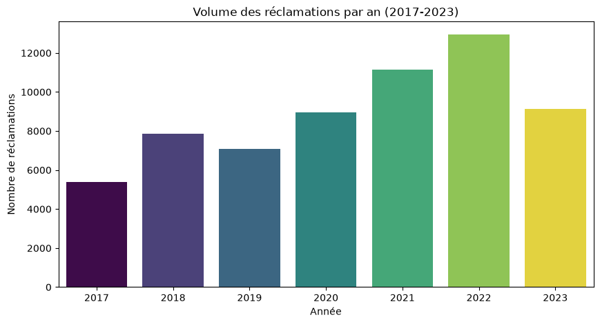
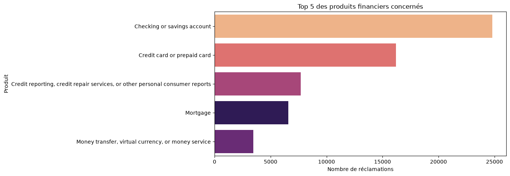
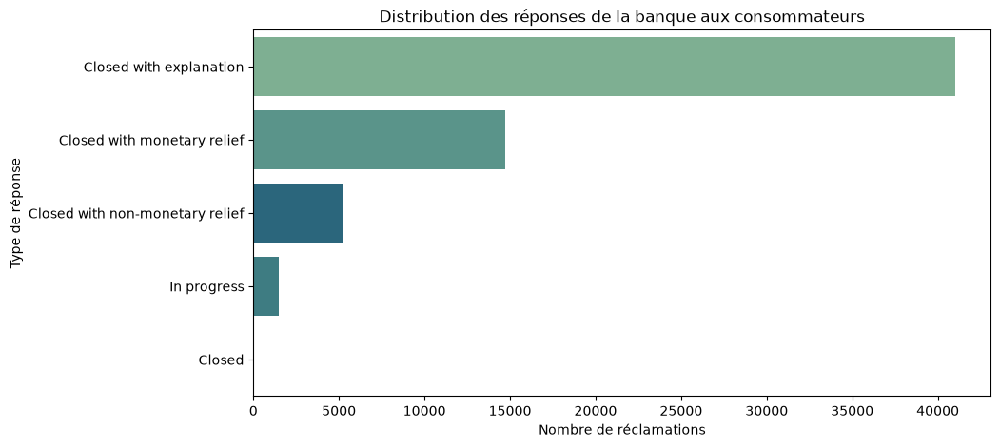
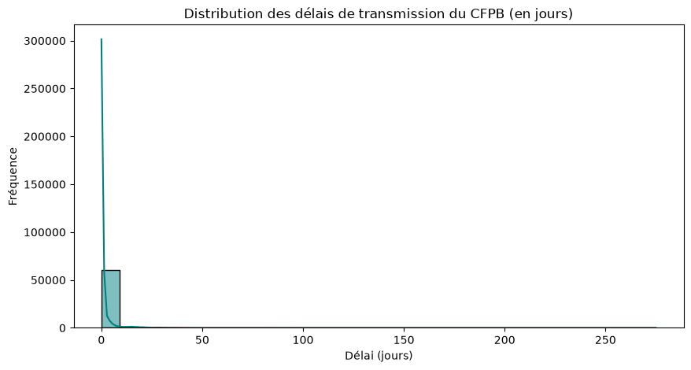
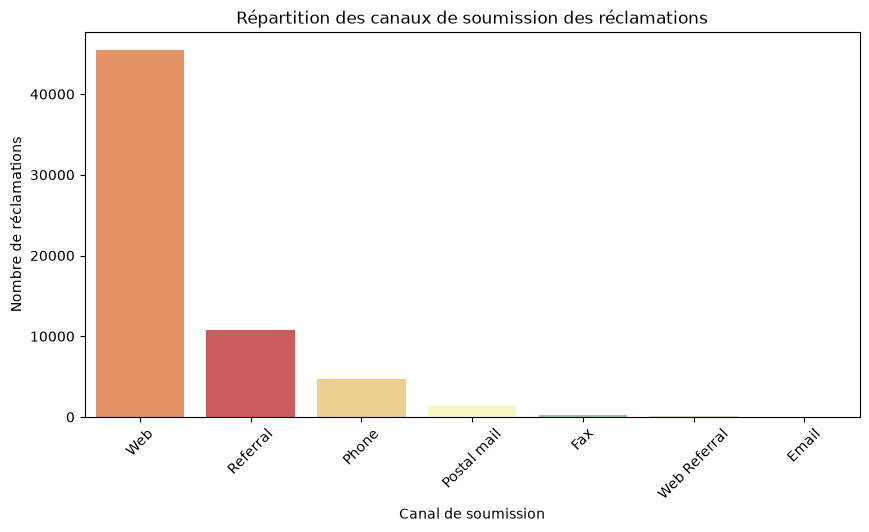
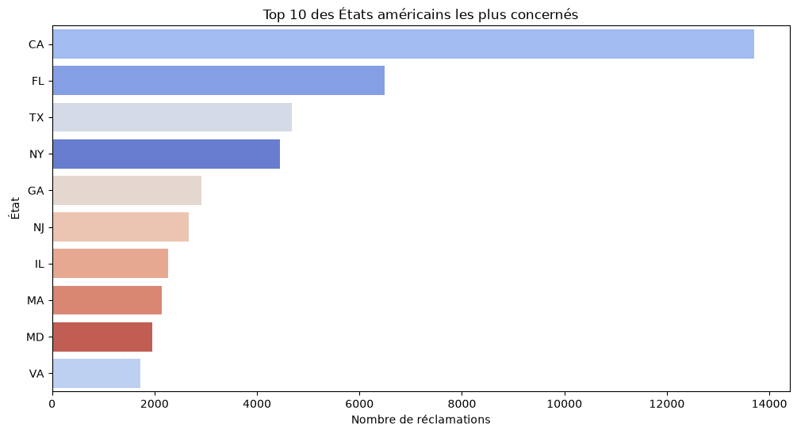

# Consumer Complaint Trends and Response Intelligence Platform (Week 4)

## Project Overview
This project investigates consumer complaint patterns and response trends based on Bank of America data (2017-2023) provided by the CFPB. The objective is to apply exploratory data analysis, feature engineering, and statistical validation to understand customer grievances and bank response timeliness.

---

## Dashboard Insights & Visualizations

### 1. Annual Complaint Volumes

### 2. Top Financial Products

### 3. Company Responses to Consumers

### 4. CFPB Processing Delay Distribution

### 5. Submission Channels

### 6. Top States

---

## Statistical Analysis (Chi-Square Test)
- **Null Hypothesis ($H_0$):** There is no association between financial product types and the timeliness of company responses.
- **Alternative Hypothesis ($H_1$):** There is a statistically significant association between product types and response timeliness.
- **Result:** $\chi^2 = 414.26$, $p\text{-value} = 1.66 \times 10^{-84}$.
- **Conclusion:** We reject $H_0$. The response timeliness of the bank strongly depends on the specific financial product category.

---

## Repository Structure
- `notebooks/` : Jupyter Notebook containing the full analysis.
- `figures/` : Exported visualizations.
- `README.md` : Project documentation.
